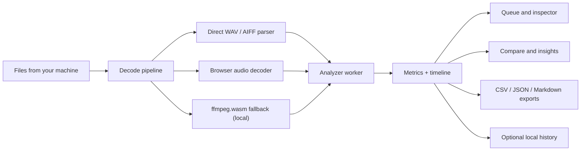

<div align="center">
  
  <h1>TruePeak</h1>
  <p>A loudness and true peak review tool that analyzes audio in your browser. Load your audio, read the numbers, compare a batch, and export the results. TruePeak has no audio-upload path.</p>

  <p>
    <a href="https://true-peak.vercel.app/">
      
    </a>
  </p>

  <p>
    
    
    
    
    
    
  </p>
</div>

> **Note**
>
> TruePeak is a review tool, not a certified broadcast compliance meter. WAV and AIFF are read directly. Compressed formats are decoded by the browser or by a local copy of ffmpeg.wasm, and codec behavior can vary a little between browsers. Use it to check your work, not to sign off a broadcast deliverable.

TruePeak puts the whole loudness review on one screen: the batch queue, per-file detail, timeline charts, target checks, and exports. You don't have to move between a meter, a normalization calculator, a file inspector, and a comparison sheet. The measurement engine implements ITU-R BS.1770/EBU R128-oriented loudness and true-peak processing and is checked against a documented subset of published EBU reference cases.

Live app: [true-peak.vercel.app](https://true-peak.vercel.app/)

## Contents

- [What it does](#what-it-does)
- [Supported files and how they are decoded](#supported-files-and-how-they-are-decoded)
- [Modes and workflows](#modes-and-workflows)
- [Theme](#theme)
- [History and session files](#history-and-session-files)
- [Exports](#exports)
- [Privacy](#privacy)
- [Security](#security)
- [Architecture](#architecture)
- [Tech stack](#tech-stack)
- [Getting started](#getting-started)
- [Scripts](#scripts)
- [Testing](#testing)
- [Deploying to Vercel](#deploying-to-vercel)
- [Project structure](#project-structure)
- [Working with large libraries](#working-with-large-libraries)
- [Limitations](#limitations)

## What it does

- Integrated LUFS, ungated loudness, and loudness range (LRA)
- Momentary and short-term loudness over time, drawn as a timeline chart
- True peak (4x oversampled) and sample peak
- Checks against a delivery preset or your own custom target, with a suggested gain move and the true peak you would get after that move
- A Measure only mode that reports the readings with no target attached
- Drag and drop on every screen, including whole folders (they are scanned for supported audio), with a batch progress bar and a rough estimate of the time left while a run is going
- A compare view for a whole batch: ranked cards, deltas against a reference file, a status board, and a dense table
- A file inspector with Overview, Timeline, and Technical tabs
- Light and dark themes
- Optional saved history of finished readings, off by default
- Exports to CSV, JSON, and a Markdown report
- Session files you can save and reopen later

Loudness range is built only from complete 3 second short-term windows. A file with fewer than two of them reports LRA as invalid instead of 0: blank in CSV and Markdown, `null` in JSON, and left out of the Compare range axis. A peak at or below -144 dBFS reads as Silence instead of a numeric floor.

## Supported files and how they are decoded

Input formats: WAV, RF64, AIFF, AIFC, MP3, AAC and M4A, FLAC, OGG, Opus, and .weba. Intake also accepts any file whose browser-reported MIME type starts with `audio/`, whatever its extension.

TruePeak picks one of three decode routes automatically, based on the file and on what your browser supports:

1. Direct parsing for WAV, RF64, AIFF, and AIFC. This is the fastest path and does no transcoding.
2. The browser audio decoder, for formats it can handle natively.
3. A local copy of ffmpeg.wasm as a compatibility fallback for anything the first two routes don't cover.

The Technical tab names the route a file took: Native parser, Browser audio, or FFmpeg (WebAssembly). If no route can read a file, it is marked as failed with a plain message that suggests what to try next, and the rest of the batch keeps going.

## Modes and workflows

The analysis mode is either Targeted or Measure only.

Targeted compares the measured loudness with a delivery target. You pick a preset or enter your own loudness target and true peak ceiling. The app shows how far the file sits from the target, the gain move that would get it there, the projected true peak after that move, and a verdict: On target, Needs gain, Too hot, or Ceiling-limited.

The verdict judges the true peak you would actually ship. Inside the loudness tolerance you ship the file as measured, so a measured peak over the ceiling reads Ceiling-limited instead of On target. Outside the tolerance you would apply the suggested gain first, so the verdict judges the peak that move would leave behind. A quiet file reads Ceiling-limited whenever its peak is already over, because adding gain only pushes it further past. A file that is too loud reads Too hot when attenuating to the target also brings the peak back inside, and Ceiling-limited when it doesn't. That happens whenever the peak is further over the ceiling than the loudness is over the target. The peak check runs under both gain policies, including Reach loudness target, which doesn't cap the move. The tolerance is exactly the one you entered, including values under 0.1 LU. Every operand in the verdict is rounded to the same 0.01 precision the display and the reports use, so a verdict can't disagree with numbers that look equal on screen. Preset ceilings follow each platform's own published guidance. Spotify Loud, for example, targets -11 LUFS with a -2 dBTP true peak ceiling.

Measure only drops the target and reports loudness, peaks, range, and the timeline as measured. Use it when you want raw readings without any delivery framing.

The workflow is either Simple or Advanced. Simple is the default: drop files in, scan the whole batch in a table, open one file at a time, and export. That covers most reviews. Advanced keeps the same session and adds the Compare and Insights tabs, which help once a session grows past a quick check of one file.

## Theme

TruePeak has a light and a dark theme. The toggle sits in the toolbar with the label Theme. On a phone, the session toolbar moves it into the More menu as Toggle color theme. The choice is stored for a year in the `truepeak-theme` cookie. A short script in `app/layout.tsx` applies it on the client before the first paint, so the page doesn't flash the wrong colors on load and `/` stays a static, cacheable shell. With no cookie set, the script follows the operating system preference and falls back to dark.

The toggle cross-fades the page with the View Transitions API. When reduced motion is on, or the browser doesn't support view transitions, the theme switches instantly. A change that doesn't come from the toggle, such as the operating system switching between light and dark while no theme is saved, also applies instantly. The browser's `theme-color` meta tags follow the active theme, using the two colors in `src/lib/theme-color.ts`.

The same pre-paint script flags a reload of a `?screen=session` URL by setting `data-boot-screen` on the root element. The static shell can only render the home screen, so `app/globals.css` hides it behind a toolbar-shaped placeholder until the app hydrates and shows the session.

The interface also supports forced-colors mode, and `prefers-contrast: more` gives every divider the stronger control-boundary color.

## History and session files

TruePeak keeps results in three places, and each has a different job.

Live session restore is automatic when IndexedDB is available. Completed results are mirrored into this browser as they finish. Saves, retries, deletes, and Clear session run one at a time, and the app shows a warning that stays on screen if the browser blocks storage or a transaction can't be committed. Restored results are view only, because the source audio doesn't survive a reload. The current target, analysis mode, custom target fields, and decoder preference are restored before results are reconciled. If those settings can't be committed to localStorage, the app keeps a warning on screen and stops adding new results to recovery, so a reload can't quietly combine them with stale settings. Removing a file still updates its existing recovery copy. Clear session reports success only after the deletion commits, and it also empties this tab's quarantined records (recovery rows that failed validation during a restore). The restore skips rows that are already in the workspace, matched by id or by the same result key the session importer uses, so a session file opened before the restore finished doesn't end up with two copies of each result. With several tabs open at once, each tab owns its recovery copies: restore shows everything it can read, but one tab clearing its session leaves the other tabs' copies alone.

Saved history is off by default. Turn it on and finished readings are saved as small summary cards in this browser only. It keeps the newest 20 valid entries, and a stored envelope with one bad row keeps its other valid rows instead of being discarded. Turning history off stops new summaries but doesn't delete existing ones; the count and the Clear saved history control stay available. Migrated legacy summaries are marked when their original validity and provenance contract is unknown. Saved history is a quick recall list, not a full session restore, and it never leaves your machine.

Session files let you save the current results to a versioned `.truepeak.json` file and reopen them later, on this machine or another one. The original audio isn't stored, so imported entries are view only and always labelled as unverified imports; trusted or compliance use needs a fresh analysis of the source audio. The importer hashes the source session, assigns fresh local IDs, keeps bounded lineage, validates the whole file in a worker, and rejects a malformed or inconsistent file outright instead of loading part of it.

The file is written as compact JSON. Summary metrics keep full precision, while timeline points are rounded to 0.01 LU or dB and to the millisecond. An oversized export fails with an explicit message. Long timelines are downsampled to fit a shared budget without changing the headline measurements, so a full 1,000-file session comes to roughly 14 MB.

Importing skips results that are already in the workspace, whether they were analyzed here, restored from the recovery copy, or imported earlier. A result counts as already present when it has the same lineage id (the id it was first analyzed under, carried through every export) and the same measured fingerprint. Two different files with the same name are both kept. When everything in the file is already there, the notice reads "Added 0 files. Skipped N already in this session."

## Exports

Completed results export to three formats, each stamped with the export time so repeated exports never overwrite each other. The stamp has one-second resolution, so a second export of the same kind inside one second gets a `-2`, `-3`, and so on. The counter is per filename family: exporting CSV and then JSON in the same second gives both the plain stamp, because their extensions already differ.

- `truepeak-analysis-YYYYMMDD-HHMMSS.csv`
- `truepeak-analysis-YYYYMMDD-HHMMSS.json`
- `truepeak-analysis-YYYYMMDD-HHMMSS.md`

Session saves and timeline CSVs follow the same pattern, each with its own counter (`truepeak-session-YYYYMMDD-HHMMSS.truepeak.json`, `truepeak-timeline-YYYYMMDD-HHMMSS.csv`). The CSV escapes quotes, commas, and line breaks, neutralizes values that a spreadsheet might otherwise treat as a formula, and starts with a UTF-8 byte-order mark so Excel reads accented filenames correctly. The Markdown file is written as a short technical handoff for the next person in the chain.

The JSON report shares the session format's aggregate budget of 500,000 timeline points across the whole export. A session over that budget has its timelines downsampled to fit, and each entry records `timelineDownsampled` and `timelineSourcePoints` so a reader can tell. Headline measurements are unchanged either way. The report keeps timeline values at full precision. It is indented up to 8 MiB and written compact above that, which keeps a large batch from doubling in size and serialization cost.

A session save is different: it is always compact and rounds its timeline points, as described in [History and session files](#history-and-session-files). Opening a session save skips any result that is already in the workspace.

## Privacy

Audio bytes, decoded PCM, measurements, session recovery data, and optional history stay in your browser. TruePeak has no audio-upload API, account system, or server-side application database. The app sends usage analytics only if the deployment operator has explicitly enabled them, and even then audio and results are never included. Telemetry is off by default everywhere. Vercel Analytics and Speed Insights mount only when the build runs on Vercel (`VERCEL=1`) and the operator also sets `NEXT_PUBLIC_ENABLE_TELEMETRY=1`; a default Vercel deployment with that flag unset sends nothing. The server reads no cookie or header from you: `/` is prerendered at build time and served as the same static shell to everyone.

## Security

Untrusted input (audio files and imported session files) goes through strict, capped validation, and a fuzzer checks those same paths on every push. Responses carry a tight Content Security Policy and related headers. The ffmpeg.wasm runtime is pinned to known fingerprints at build time, and CI fails when a runtime dependency carries a serious known advisory. [SECURITY.md](./SECURITY.md) covers the threat model, the protections, the accepted risks, and how to report a problem.

## Architecture

Everything runs in the browser. You bring files in from your machine, background workers decode and analyze them, and one screen holds the queue, the detail view, the compare state, and the exports.



Direct container decoding, compatibility decoding, and analysis run in Web Workers. The browser-codec route has to use Web Audio on the page's main realm. Canceling one of those decodes shows up at once, but the scheduler keeps that file's lane until the browser's uninterruptible `decodeAudioData()` work has actually drained. Every route gets the same source, channel, frame, duration, decoded-byte, output-byte, and execution-time budget.

Before admitting work, the queue reserves the memory each decode route will hold at its peak and keeps the total under an aggregate limit. Browser decoding counts both the `AudioBuffer` and its planar copy. Compatibility decoding counts the source bytes plus three decoded-size PCM copies: the float-WAV output in the ffmpeg filesystem, the copy read back out of it, and the parsed planar PCM. A file with a known footprint reserves the peak of the route it will take and shares the aggregate with other files. Media with an unknown footprint holds a full conservative reservation, so large opaque files run alone. Capped or truncated decoder output is rejected, and messages from stale worker generations are ignored.

Two more safeguards sit under that model. Browser decodes wait in a first-in, first-out window that admits as many at a time as there are analysis lanes, because `decodeAudioData()` allocates its output before the result can be checked; the reservation each decode already holds is what bounds the memory. And when a decoder fallback needs a bigger reservation than the aggregate can grant at that moment, the job goes back to the queue and retries once capacity frees up, so it doesn't fail. Idle workers shut down after the queue goes quiet.

## Tech stack

| Area | Choice |
| --- | --- |
| Framework | Next.js 16 (App Router) |
| UI | React 19 |
| Styling | Tailwind CSS 4 |
| Charts | uPlot |
| Audio decode | Browser decoder plus `@ffmpeg/ffmpeg` and `@ffmpeg/core` |
| Workers | Web Workers for decode and analysis |
| Icons | Lucide |
| Analytics | Vercel Analytics and Speed Insights, off by default, mounted only on Vercel with `NEXT_PUBLIC_ENABLE_TELEMETRY=1` |

## Getting started

The app is hosted at [true-peak.vercel.app](https://true-peak.vercel.app/), so you can use it without installing anything. To run it locally:

You need Node.js 24 or newer (`package.json` declares `engines.node >= 24`) and npm. The application build runs on Node 20+, but the test scripts use Node's native TypeScript support, which needs 24.

Install dependencies:

```bash
npm install
```

A postinstall step checks the SHA-256 hash of every ffmpeg asset against the values pinned in `scripts/prepare-ffmpeg-assets.mjs`, then copies them into versioned paths under `public/vendor/ffmpeg`: `core/0.12.9/` for `@ffmpeg/core` and `ffmpeg/0.12.15/` for the `@ffmpeg/ffmpeg` class worker. A hash that doesn't match stops the install.

Start the dev server:

```bash
npm run dev
```

Open http://localhost:3000. The dev server also accepts http://127.0.0.1:3000, because `next.config.ts` lists `127.0.0.1` in `allowedDevOrigins`.

For a first run, stay in Simple and add a few WAV or AIFF files (drop them anywhere, folders included). Pick Targeted if you want delivery guidance or Measure only if you just want readings, scan the table, then open a file in the inspector. Switch to Advanced when you want Compare and Insights. There are two keyboard shortcuts: `/` focuses the queue search and `Ctrl/Cmd+O` opens the file picker.

On a small screen the toolbar collapses into a More sheet. That sheet and the confirmation dialogs each take one browser history entry, so hardware Back closes them without leaving the session. Under each timeline chart is a readout row that follows the cursor and also responds to a touch drag. If the browser reports Data Saver or a 2G connection, TruePeak says so once and leaves the roughly 31 MB compatibility decoder off until you allow the download under Advanced options.

## Scripts

| Script | What it does |
| --- | --- |
| `npm run dev` | Start the local dev server |
| `npm run build` | Production build |
| `npm run start` | Run the production build locally |
| `npm run lint` | Run ESLint |
| `npm run typecheck:scripts` | Type check the validation scripts through `tsconfig.scripts.json` |
| `npm run prepare:ffmpeg` | Verify the pinned ffmpeg hashes and copy the assets into `public/vendor/ffmpeg` |
| `npm test` | Run all thirteen validation suites (see below) |
| `npm run test:dsp` | Reference signal checks for the DSP engine |
| `npm run test:ebu` | EBU Tech 3341/3342 reference-subset checks |
| `npm run test:session` | Session file round trip, import dedupe, and rejection checks |
| `npm run test:robustness` | Bad and adversarial input checks |
| `npm run test:export` | CSV, JSON, and Markdown export checks |
| `npm run test:presets` | Delivery preset and custom-target validation checks |
| `npm run test:live-session` | Cross-tab persistence, clear/save ordering, and provenance recovery checks |
| `npm run test:runtime` | Decoded-resource budget, cancellation draining, and bounded folder traversal checks |
| `npm run test:scheduler` | Lane admission, cancellation, and transport-fault checks for the analysis scheduler |
| `npm run test:route` | Workspace URL normalization checks |
| `npm run test:job-ui` | Badge, filter, sort, and session-statistics checks for the queue |
| `npm run test:render` | React server-render smoke over the result components |
| `npm run test:fuzz` | Seeded fuzz cases over every untrusted-input parser |

## Testing

`npm test` runs thirteen suites in `scripts/dsp/` through `node --test`, each in its own process, for 2,622 tests in total:

- DSP (145) measures known reference signals, validity boundaries, per-rate accuracy at 44.1, 88.2, 96, and 192 kHz, channel weighting (including the maskless fallbacks agreeing with the speaker-mask path), peak and timeline invariants, repeatability, and targeting and compliance behavior. It also runs the gated true-peak stage against an ungated reference loop over 3,008 seeded noise, music-like, silent, DC, square-wave, late-peak, and late-spike signals, and requires every headline and timeline true-peak value to match exactly. The chunked K-weighting pass has to match a full-length pass, bit for bit on the momentary and short-term timelines.
- EBU reference subset (25) reproduces the published EBU Tech 3341 and 3342 cases that can be synthesized from their documented parameters, and asserts the standards' own expected readings. It runs 17 of the 23 Tech 3341 cases and 4 of the 6 Tech 3342 cases. The rest (Tech 3341 cases 7, 8, and 20 to 23, and Tech 3342 cases 5 and 6) need the EBU reference-audio downloads or 4x-fs synthesis and are not reproduced. Passing this subset is not EBU certification.
- Session files (109) cover v2 round trips, v1 compatibility, provenance, whole-file rejection, cross-field invariants, aggregate timeline limits, UTF-8 size limits, and portable downsampling. They also check the compact format and timeline rounding, a 1,000-file session that has to export under the import limit and round-trip, and import and restore dedupe against live, restored, and previously imported rows.
- Robustness (108) feeds malformed parser and analyzer inputs, unsupported rates, RF64/AIFC edge cases, duplicate-chunk containers that would otherwise decode geometry the preflight never saw, and hostile resource declarations through fail-closed paths.
- Export (109) checks measurement-validity wording, provenance, CSV formula neutralization, Markdown and HTML structure escaping, selectors, the JSON timeline cap, and the timestamped filename contract, including same-second collisions.
- Presets (110) checks the delivery presets and the custom-target flow: field validation, range boundaries, modified and reset state, and round trips.
- Live session (26) exercises persistence races, clear/save ordering, cross-tab ownership and heartbeat refresh, quarantine cleanup, and provenance recovery for the IndexedDB-backed live session store.
- Runtime (136) exercises decoded-resource budgets and the large-tier footprints of real high-resolution masters, container preflight against inconsistent header geometry, reservation contention handling, the browser-decode window, FLAC footprint corroboration, the half-frame tolerance in the STREAMINFO and probe duration checks, cancellation draining, and bounded folder traversal.
- Scheduler (19) drives the real `AnalysisScheduler` over a fake lane transport: lane-limit admission, cancel while queued and while decoding, escalation to an exclusive rerun, transport faults retiring a lane, and the progress checkpoints a worker-route job passes through. It also drives the real admission subscriber. Progress commits must never trigger a queue scan, and a released lease, a retired lane, a raised lane limit, a resumed circuit, unblocked analysis, and a retried row must each admit the next job without one.
- Fuzz (1,813) is a seeded, reproducible fuzzer. It mutates valid WAV, AIFF, FLAC, and session files, adds raw noise, and runs all of it through every parser that touches untrusted bytes. Each case has to fail cleanly or produce sane output inside a time budget. A differential stage takes 11 WAV and AIFF corpora, mutated and unmutated, and asserts that the pre-flight inspector and the native parser agree on channel count, bit depth, and frame count, with an allocation guard that fails the case if the parser allocates before the geometry is checked. The seed is fixed, so any failure reproduces exactly.
- Route (8) checks that a workspace URL normalizes to one canonical form, so session-only and mode-only params are dropped when they no longer apply.
- Job UI (12) checks queue badges, search haystacks (including a retargeted job's new verdict), natural filename sorting, batch progress, and the session statistics that skip invalid readings.
- Render smoke (2) server-renders the real result components and asserts the actionable error copy, view-only hints, paused rows, circuit retry, the single batch-idle summary, and the null-gapped loudness series the chart receives.

Each suite is also a script of its own (`npm run test:dsp` and so on), or you can run one file directly with `node --test scripts/dsp/validate-runtime.mjs`. To run a single case, put `--test-name-pattern` before the file path: `node --test --test-name-pattern="FLAC" scripts/dsp/validate-runtime.mjs`.

The suites run the real TypeScript source directly through Node, with a small loader that maps the `@/` path alias and transpiles `.tsx`. Each file registers the loader itself instead of using `--import`, because Node's module-hook thread snapshots the environment before a file can set the variables the render smoke depends on. Running the source directly is why the suites need Node 24. `npm run typecheck:scripts` type checks the scripts through `tsconfig.scripts.json`, which applies the repository's strict settings with `checkJs` on to every `scripts/dsp/**/*.mjs` file, so the suites are checked against the app's own types.

`tests/compatibility.spec.mjs` is a separate Playwright suite of seven Chromium cases that runs against the production build, locally and in CI. To run it: `npm run build`, then `node scripts/dsp/make-alaw-test-audio.mjs` to generate the two WAV fixtures it loads into `public/test-audio/`, then `npx playwright test --project=chromium`. It covers the cacheable static shell and the theme-color meta tags, an a-law file completing through the compatibility decoder, the plain error shown when the local ffmpeg core can't load, hardware Back dismissing the mobile More sheet and the confirmation dialog, Data Saver keeping the compatibility download opt-in, the loudness chart drawing its LUFS axis, and a touch drag moving the timeline readout.

## Deploying to Vercel

The current build is live at [true-peak.vercel.app](https://true-peak.vercel.app/). To deploy your own copy:

1. Push the repository to GitHub.
2. Import the project into Vercel.
3. Deploy.

Notes:

- It is a normal Next.js app and needs no special configuration.
- Social preview and canonical URLs (`metadataBase`, Open Graph, Twitter card) resolve from `NEXT_PUBLIC_SITE_URL` if set, otherwise from Vercel's auto-injected `VERCEL_URL`, otherwise from the canonical deployment above. Set `NEXT_PUBLIC_SITE_URL` on your own fork if you want shared links to point at your custom domain instead of the deployment URL.
- `/` is prerendered at build time and served as a static, cacheable shell; the theme is resolved on the client before the first paint. All audio decoding and analysis runs in the browser.
- Analytics and Speed Insights are off by default. They mount only when the build runs on Vercel (`VERCEL=1`) and you also set `NEXT_PUBLIC_ENABLE_TELEMETRY=1`. A default Vercel deployment without that flag sends no telemetry.
- `npm run prepare:ffmpeg` generates `public/vendor/ffmpeg` and runs automatically on install, dev, and build, so the directory isn't committed. The assets sit under version-stamped paths (`core/0.12.9/`, `ffmpeg/0.12.15/`), and `next.config.ts` serves that directory with `Cache-Control: public, max-age=31536000, immutable`.
- No server-side database, auth, environment variables, or custom API are required; browser recovery uses IndexedDB.

## Project structure

```text
truepeak/
├── app/
│   ├── error.tsx             (styled recovery screen for crashes)
│   ├── global-error.tsx      (fallback when the root layout itself fails)
│   ├── globals.css           (theme tokens, motion easing, forced-colors and contrast rules)
│   ├── layout.tsx            (static shell and the pre-paint theme script)
│   ├── manifest.ts
│   ├── not-found.tsx
│   ├── opengraph-image.png   (social preview card)
│   └── page.tsx
├── public/
│   ├── favicon.png
│   ├── icon-maskable.png
│   ├── logo.png
│   ├── logo-96.png           (in-app logo mark)
│   └── vendor/ffmpeg/        (generated, not committed: core/0.12.9, ffmpeg/0.12.15)
├── scripts/
│   ├── prepare-ffmpeg-assets.mjs
│   ├── prune-worker-sources.mjs
│   └── dsp/                  (validation suites, alias loader, lib/ container and object fixtures)
├── src/
│   ├── analysis/             (scheduler, job store, run-analysis-job, lane reservations)
│   ├── audio/                (parsers, DSP, targeting, export, decode budgets)
│   ├── components/           (workspace UI, workspace-contexts.tsx)
│   ├── hooks/                (route, intake, settings, queue view, overlay history, exit presence, worker orchestration)
│   ├── lib/                  (workspace-route, session-selectors, job-ui, formatting, preferences, theme-color)
│   ├── session/              (live session store, controller, local persistence)
│   ├── types/
│   └── workers/              (decoder, analyzer, session-import workers)
├── tests/
│   └── compatibility.spec.mjs  (Playwright Chromium suite)
├── eslint.config.mjs
├── next.config.ts
├── package.json
├── playwright.config.mjs
├── postcss.config.mjs
├── tsconfig.json
└── tsconfig.scripts.json
```

The logo is a plain `` of `public/logo-96.png` because images are served unoptimized (`images.unoptimized` in `next.config.ts`), so the app doesn't use `next/image`. `src/hooks/use-exit-presence.ts` keeps drawers and confirmation dialogs mounted long enough to play their exit animation. `src/lib/theme-color.ts` holds the browser-chrome color for each theme, shared by the viewport metadata and the runtime theme switch.

## Working with large libraries

The scheduler sizes each job by its decoded footprint, not its compressed file size. Container metadata is read from a bounded header slice where it can be trusted (PCM WAV and AIFF, and FLAC, including large masters), so several files with a known footprint analyze in parallel when their combined reservations fit the device's aggregate budget. A compressed source that no header check covers goes through a bounded ffprobe pass in the decoder worker before anything is allocated, and its reservation is sized from what the probe reports. A FLAC header whose declared footprint can't account for the file's own size isn't trusted, and the file falls back to the conservative reservation. Files without a trustworthy pre-decode footprint hold that conservative reservation, so they run one at a time. Each decode is bounded by source bytes, decoded bytes, output bytes, channels, frames, duration, and elapsed time, and the compatibility path rejects capped or inconsistent output instead of analyzing a truncated file.

How long a file can be depends on the device's tier. A device gets the large tier when the browser reports 8 GB or more of memory through `navigator.deviceMemory` (Chrome never reports more than 8). Browsers that don't report memory, such as Safari and Firefox, get the large tier when the device has a fine pointer like a mouse or trackpad. Everything else gets the default tier: devices that report less than 8 GB, and devices with a touch-first (coarse) pointer that report no memory at all. Decoded audio is held as 32-bit float, so the working memory converts to minutes of stereo audio like this:

| | Default tier | Large tier |
| --- | --- | --- |
| Decoded working memory | 256 MiB | 1.5 GiB |
| Source file size | 512 MiB | 1.5 GiB |
| Stereo at 48 kHz | about 11.5 minutes | about 69 minutes |
| Stereo at 96 kHz | about 5.8 minutes | just under 35 minutes |
| Stereo at 192 kHz | about 2.9 minutes | about 17 minutes |
| Decode time limit | 2 minutes | 4 minutes |

On the large tier, the 200 million frame cap binds slightly before the memory cap at all three rates. More channels shorten the limit in proportion: a 5.1 file gets about a third of the stereo time while the memory cap is the one that binds. No file can be longer than 6 hours or have more than 32 channels.

When a file doesn't fit, the error names this device's limit. A file that needs too much decoded memory gets a message naming the budget ("256 MB" or "1.5 GB") and suggesting a 48 kHz or 96 kHz copy, a shorter one, or one with fewer channels. A file over the source-size limit gets a message with the device's source limit and how many minutes of stereo 48 kHz audio its working memory holds (about 12 on the default tier, about 70 on the large tier).

One session holds at most 1,000 files, and the same limit applies everywhere: intake, recovery restore, session export, and session import. Intake counts every file already in the session, so a run of adds can never push the total past 1,000. Files beyond the remaining room are turned away and reported in a notice that doesn't time out. An over-limit session export fails with an explicit message, an over-limit import is rejected whole, and recovery restores the newest 1,000 records and leaves any extra stored records in place. Recovery reads IndexedDB schema v2: the restore walks a newest-first index, and a record that fails validation is moved to a quarantine store instead of being deleted.

Folder drops stop during enumeration at file, entry, depth, page, and time budgets (2,000 files, 8,000 entries, depth 12, 256 pages, 5 seconds). A drop with more than 2,000 files gets a notice that only the first 2,000 were considered. These budgets protect the traversal and are separate from the 1,000-file session limit.

A session file can hold the whole 1,000-file session. Its timelines share a budget of 500,000 points across the file, and the points are rounded and written compactly, so a full session with five-minute timelines comes to about 14 MB, well under the 64 MiB import limit. The file count is the limit you will reach first.

Parallel lanes still speed up normal desktop batches, but browser codec support and memory behavior vary. On codecs without trustworthy pre-decode metadata, Web Audio can allocate its output before TruePeak can check the result. Those decodes go through the browser-decode window described in [Architecture](#architecture), every result is validated before it is copied or analyzed, and a canceled decode is drained before its lane is reused. For unusually heavy libraries, smaller batches and regular session exports are still the safest workflow.

## Limitations

- A session holds at most 1,000 files, and one folder drop considers at most 2,000 files. A session file is limited to 64 MiB, which a full 1,000-file session doesn't come close to.
- Each file has to fit the device's decode budget: about 11.5 minutes of stereo 48 kHz audio on the default tier (2.9 minutes at 192 kHz), and about 69 minutes on the large tier (about 17 minutes at 192 kHz). [Working with large libraries](#working-with-large-libraries) has the full table.
- Completed results are restored automatically after a refresh and marked with a Restored badge. Files that were still queued or running are not: the browser can't keep file handles across a reload, so unfinished work has to be added again.
- Restored results and session files store readings and charts, not the source audio, so they can't be analyzed again. Session files also round timeline points to 0.01 LU or dB and 1 ms.
- Saved history keeps summary cards only, not full sessions.
- Automatic recovery depends on browser IndexedDB. Storage failures are reported, but a downloaded session file is the portable backup.
- Compressed format behavior can vary slightly by browser and codec support.
- Telemetry is off by default. Analytics and Speed Insights send visit and performance data only when the build runs on Vercel with `NEXT_PUBLIC_ENABLE_TELEMETRY=1`; audio and measurement content are never sent through those integrations.
- The EBU harness is a reference subset, not certification. The earlier DSP and parser gaps are now handled (WAVE quad-mask weighting, 400 ms validity at odd rates such as 11,025 Hz, complete-window LRA, RF64 declared-size handling, and mandatory AIFC conformance). The suite stays a subset because Tech 3341 cases 7, 8, and 20 to 23, and Tech 3342 cases 5 and 6, need EBU reference-audio downloads or 4x-fs synthesis, so passing it is not a standards conformance guarantee.
- Low sample rates read slightly loud. The K-weighting filter is re-derived per sample rate with a pre-warped bilinear transform, which matches the 48 kHz reference response almost exactly at normal delivery rates but steepens near Nyquist at low sample rates. For programme sampled below roughly 24 kHz with substantial energy in its top octave, integrated, momentary, and short-term loudness can read up to about 0.4 LU higher than the same audio would measure at 48 kHz (for example, roughly +0.43 LU at 8 kHz, +0.10 LU at 16 kHz, and +0.06 LU at 22.05 kHz for a top-octave-heavy signal). 44.1 kHz and 48 kHz and above are effectively unaffected (well under 0.01 LU). True peak measurement is not affected.
- Shipping ffmpeg.wasm locally adds some weight, in exchange for not depending on a third-party runtime fetch.
- This is a review aid. It has been validated against reference signals and a documented subset of EBU cases, but it is not a certified compliance meter.
