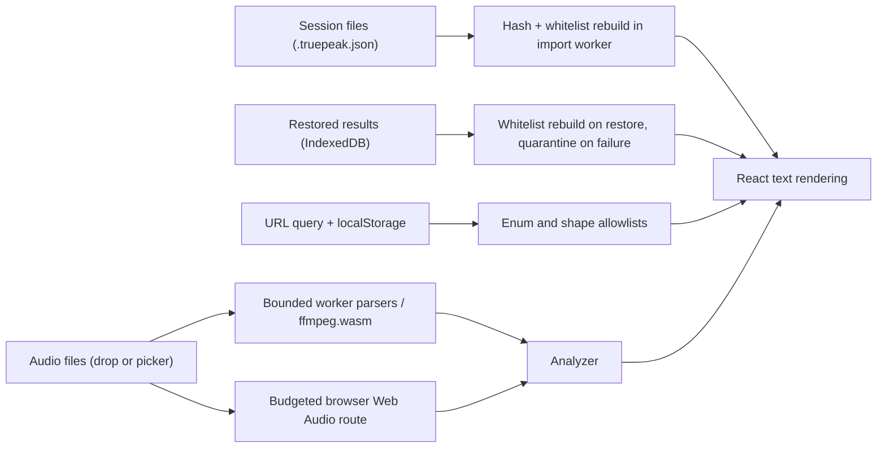

<div align="center">
  
  <h1>Security</h1>
  <p>How TruePeak handles untrusted input, what protects the app and your data, which risks are accepted on purpose, and how to report a problem.</p>

  <p>
    <a href="https://github.com/rsvptr/truepeak/actions/workflows/ci.yml">
      
    </a>
    
    
  </p>
</div>

> **Note**
>
> TruePeak reads, decodes, and analyzes audio on your machine. It has no audio upload path, no server-side application database, and no account system. Local recovery uses browser IndexedDB. Telemetry is off by default: Analytics and Speed Insights mount only when the build runs on Vercel (`VERCEL=1`) and the operator also sets `NEXT_PUBLIC_ENABLE_TELEMETRY=1`. With that opt-in on, visit and performance telemetry is the one thing that goes over the network, and those integrations do not send audio bytes or measurement content. This document covers untrusted input, local persistence, resource exhaustion, and making sure the code the app ships is the code that was reviewed.

Parsers and decode routes are bounded, validated, and fuzzed. Pages ship with a strict Content Security Policy and related headers, the embedded ffmpeg.wasm bytes are pinned by fingerprint, and CI checks the main paths on every push. Two things sit outside those protections and are covered under accepted risks below: the optional hosted telemetry, which stays off unless explicitly enabled, and the age of the pinned FFmpeg core.

## Contents

- [The security model](#the-security-model)
- [What an attacker could try](#what-an-attacker-could-try)
- [How untrusted input is handled](#how-untrusted-input-is-handled)
- [Limits on untrusted input](#limits-on-untrusted-input)
- [Headers the pages ship with](#headers-the-pages-ship-with)
- [What is stored where](#what-is-stored-where)
- [Supply chain](#supply-chain)
- [Continuous verification](#continuous-verification)
- [Check it yourself](#check-it-yourself)
- [Accepted risks](#accepted-risks)
- [Reporting a vulnerability](#reporting-a-vulnerability)

## The security model

Audio processing and result storage happen on your machine. `/` is prerendered at build time and served as a static, cacheable shell with no per-user state, and the server reads no cookie or header from the visitor. A build loads the same-origin Vercel telemetry endpoints only when the operator opts in with `NEXT_PUBLIC_ENABLE_TELEMETRY=1` on Vercel. No application data passes between users, so a hostile file mostly affects the browser session that opened it.

That browser session is what needs defending. An attacker should not be able to run script in the app's origin, crash or hang the tab, quietly corrupt your stored results, or swap the shipped code for something unreviewed.

## What an attacker could try

Untrusted input reaches TruePeak in three ways, and each passes through its own validation layer before anything else sees it:



1. Audio files you open or drop: WAV, RF64, AIFF, AIFC, and the compressed formats. These go to hand-written binary parsers, the browser's own decoder, or a locally served copy of ffmpeg.wasm.
2. Session files (`.truepeak.json`) you import, which someone else may have made. The app's own saved results, read back from IndexedDB after a refresh, get the same suspicion.
3. The URL query string and localStorage, which hold workspace state and preferences.

The realistic attacker goals are running script in the app's origin (XSS), denial of service against the tab (hangs, memory exhaustion, crashes), and substituting the shipped code (supply chain). The sections below deal with each of them.

## How untrusted input is handled

**Audio files.** The WAV/RF64 and AIFF/AIFC parsers bound field reads and allocations and reject incomplete metadata, including an RF64 data size larger than the physical bytes and an AIFC file missing its mandatory FVER chunk. The parsers and the pre-flight inspector walk containers with one shared bounded chunk iterator. Before it allocates the first `Float32Array`, the parser hands its channel count, bit depth, and frame count back to the worker, which compares them with the pre-flight geometry. A header that reads one way during admission and another way during decode therefore fails instead of sizing a buffer. Checked arithmetic enforces source, decoded, output, channel, frame, duration, and time budgets before or during every decode route. A compressed source is sized from a bounded header sniff, or from a bounded ffprobe run in the decoder worker when no sniff covers it, before any decode buffer is allocated. Probe metadata must be internally consistent, and a frame count that falls more than half a frame short of the reported duration is rejected. FFmpeg output is probed again before analysis and rejected if a cap was hit or the decoded frame or byte metadata is inconsistent. Anything that fails becomes a structured, actionable job error, and the rest of the batch continues.

**Worker isolation and lane ownership.** Direct and compatibility decoding and analysis run in Web Workers. Browser-native codecs use Web Audio in the page realm, because that API is not consistently available in workers. Every active job owns an immutable lane lease and worker generation. Stale events are ignored, a worker restart cannot hand the lane to another job, and cancellation keeps ownership until any uninterruptible browser decode has drained. If worker construction fails synchronously, the partially created workers are cleaned up and the affected row is settled. ffmpeg.wasm runs in the decoder worker and loads its class worker, core, and wasm only from the app's own origin, at the version-stamped paths `/vendor/ffmpeg/ffmpeg/0.12.15/` and `/vendor/ffmpeg/core/0.12.9/`.

**Session files and restored results.** Imports are hashed and rebuilt in a dedicated worker. Every consumed field is checked for type and cross-field consistency, capped in length or count, and copied into a fresh object. One malformed row rejects the whole file. Imported IDs are replaced, and a file cannot grant itself trusted provenance or forge the SHA-256 that the app associates with its actual source bytes. Imported results stay marked unverified through re-export and IndexedDB recovery. An import skips any row whose result is already in the workspace, whether that row was measured live, restored from recovery, or imported earlier. The match uses the row's lineage id plus its measured fingerprint (file name, analysis time, frame count, sample rate, channel count, integrated loudness, true peak, and loudness range). A skipped row never replaces the existing one, so an import cannot change the provenance of a row already there, and the rows that remain still count against the 1,000-job session cap.

The same whitelist rebuild runs on recovery records, which are read from IndexedDB schema v2. The restore walks a newest-first `createdAt` index and stops at the 1,000-record session limit. A record that fails validation within that newest-first region is moved to a quarantine store instead of being deleted. Records beyond the limit stay in place and are reported as overflow. A restore deletes no record, and the read is transactional, so a failed quarantine move rolls back instead of dropping the record. The restore also skips recovered rows that are already in the workspace, by id or by the same result match an import uses. Clear session empties the quarantine store along with the live one, under the same ownership rule and in the same transaction, so set-aside records cannot pile up without bound. A restore also refreshes the heartbeat on the rows it claims and starts the keep-alive timer. Without that, a tab that recovers a session and then never writes would keep a frozen timestamp, and its peers would start treating it as crashed while it was still open.

**Settings and recovery consistency.** Target, mode, custom target fields, and decoder preference are validated before storage. An invalid text draft never replaces the last valid target snapshot. If localStorage refuses the settings write, the app shows a persistent warning and stops adding new completed results to IndexedDB recovery until a later settings write succeeds. Deletes and an explicit Clear session remain available. This keeps recovery from silently applying stale settings to newly measured results.

**The URL and localStorage.** Workspace state in the query string (the active tab, filters, sort, and so on) is matched against fixed lists of allowed values, and an unknown value falls back to a default before it reaches any logic. Three params carry user content instead of an enum: `search`, which holds the queue search text and so fragments of local filenames, and the session-local `job` and `reference` ids. These three are stripped from the page URL before it reaches the optional telemetry integrations. Preferences read from localStorage are validated the same way. Stored history is bounded in count, string length, dates, and numbers. Current envelopes require explicit validity and provenance state, and migrated summaries are marked when the legacy contract is unknown.

**Rendering and exports.** Untrusted strings render through React text interpolation. The app injects no raw HTML for user data. The single inline script is a fixed pre-paint snippet that sets the theme and flags a reload into the session screen. CSV fields are quoted and formula-neutralized. Markdown report fields escape headings, links and images, HTML, separators, and line breaks, so a hostile filename cannot restructure the report. JSON, CSV, and Markdown exports label unverified imported provenance prominently. Records that carry the current validity flag never present the internal `-70` invalid-measurement sentinel as a real integrated reading. Older records without that flag are treated as legacy or unknown wherever that distinction is available.

## Limits on untrusted input

Caps keep a hostile or simply enormous input from turning into a memory problem. These are the enforced numbers from the source:

| Input | Limit |
| --- | --- |
| Session file size | 64 MiB per import. Exports are compact JSON, with timeline loudness and true-peak values rounded to 0.01 and timeline times to 1 ms (a series whose rounded times would not be strictly increasing keeps its source times; summary metrics keep full precision). An export that would exceed 64 MiB fails without creating a file |
| Jobs per session file | 1,000 |
| Timeline points per portable session | 500,000 aggregate (exports downsample) |
| Short strings (names, labels) | 512 characters |
| Long strings (notes, descriptions) | 2,000 characters |
| Notes and warnings per result | 64 entries |
| Jobs accepted into a running session | 1,000 for the whole session, counted across every add instead of per add |
| Source / decoded / decoder-output bytes per job | 512 MiB / 256 MiB / 257 MiB on constrained devices. 1.5 GiB / 1.5 GiB / 1,537 MiB on devices that report 8 GB or more of memory, or that report no memory but have a fine pointer. That is about 17 minutes of stereo 192 kHz or about 35 minutes at 96 kHz, and at both rates the 200 million frame cap binds just before the byte cap. Hard ceilings that no caller can raise: 2 GiB / 1.5 GiB / 1,537 MiB |
| Aggregate modeled decode-route residency | One conservative route peak (1,282 MiB) on constrained devices. 8,196 MiB on devices that get the large tier, which is two conservative peaks of the former 1 GiB tier, so raising the per-job tier to 1.5 GiB did not raise it. Known footprints come from PCM WAV/AIFF headers, FLAC STREAMINFO, or a bounded compressed-source probe. Browser decoding reserves two decoded copies. Compatibility decoding reserves the source plus three decoded-size copies. Unknown footprints reserve a full conservative peak, so they run one at a time, and large unknown sources run alone |
| Channels / frames / duration / decode time | 32 / 200 million / 6 hours / 2 minutes per job on constrained devices. The large-memory tier allows 4 minutes of decode time |
| Folder traversal | 2,000 files, 8,000 entries, depth 12, 256 pages, 5 seconds |

A single limit of 1,000 jobs governs intake, recovery restore, portable export, and portable import. Intake counts every job already in the session, so a sequence of adds can never push the total past 1,000. Files beyond the remaining room are turned away and reported, never dropped silently. An over-limit session export fails explicitly, an over-limit import is rejected instead of truncated, and a restore brings back the newest 1,000 records, reports the overflow, and leaves the extra stored records in place. The folder-traversal limit of 2,000 files is a separate safeguard on enumerating a dropped folder, not a session cap; intake still caps enqueued jobs at 1,000. Folder enumeration stops as soon as any traversal limit is reached.

## Headers the pages ship with

Every response carries a defensive header set. The Content Security Policy matters most. It blocks every external script, style, and connection origin, which closes the usual exfiltration route even if a markup injection were ever found.

| Header | Value (production) | What it prevents |
| --- | --- | --- |
| `Content-Security-Policy` | `default-src 'self'; script-src 'self' 'unsafe-inline' 'wasm-unsafe-eval'; style-src 'self' 'unsafe-inline'; img-src 'self' data: blob:; font-src 'self' data:; connect-src 'self' blob:; media-src 'self' blob:; worker-src 'self' blob:; manifest-src 'self'; object-src 'none'; base-uri 'self'; form-action 'self'; frame-ancestors 'none'; upgrade-insecure-requests` | Loading script from, or sending data to, anywhere external |
| `X-Frame-Options` and `frame-ancestors` | `DENY` and `'none'` | Clickjacking inside an iframe |
| `X-Content-Type-Options` | `nosniff` | MIME type confusion |
| `Referrer-Policy` | `strict-origin-when-cross-origin` | Leaking URLs to other sites |
| `Cross-Origin-Opener-Policy` | `same-origin` | Window handle attacks from popups |
| `Permissions-Policy` | Camera, microphone, geolocation, payment, and USB all disabled; the screen wake lock allowed for the app itself | Quiet use of sensitive browser features |
| `Strict-Transport-Security` | `max-age=63072000; includeSubDomains` | Downgrade to plain HTTP on a self-hosted `next start` (Vercel sets its own) |

`script-src` has no `blob:`. The ffmpeg.wasm runtime loads its class worker, core, and wasm from `/vendor/ffmpeg/` on the app's own origin, and workers are admitted by `worker-src`. Production drops `'unsafe-eval'` entirely. `'wasm-unsafe-eval'` is enough for ffmpeg.wasm to compile, and the Playwright suite exercises that exact path against the production build under this policy. Development keeps `'unsafe-eval'` for the bundler's hot reload and for nothing else.

## What is stored where

Audio and result content stays on your machine. This table covers local state and the optional telemetry exception.

| Store | What lives there | Cleared by |
| --- | --- | --- |
| Cookie (`truepeak-theme`) | Light or dark, kept for one year, `SameSite=Lax`, `Secure` over HTTPS. Read only in the browser, by the pre-paint script in `app/layout.tsx`; no route reads it on the server | Switching themes or clearing cookies |
| localStorage | UI, analysis, and decoder preferences; a count of files still in progress, so a reload can report how many were interrupted; and optional history summaries (off by default, newest 20 valid entries; turning history off does not delete existing summaries) | Clear saved history removes the summaries. The in-progress count is removed when no files are pending. Clearing site data removes everything |
| sessionStorage (`truepeak-live-session-owner`) | A per-tab id that, joined to a nonce held only in memory, marks which tab owns each recovery record, so one tab cannot clear or delete a live peer's records | Closing the tab or clearing site data |
| IndexedDB (`truepeak-live-session`, schema v2) | Completed results for the live session in a `jobs` store, so a refresh does not lose a finished batch, plus a `quarantine` store for malformed recovery records set aside during restore | Removing files, Clear session (which empties both stores), or clearing site data |
| Vercel Analytics / Speed Insights | Off by default; only when the build runs on Vercel with `NEXT_PUBLIC_ENABLE_TELEMETRY=1`. Visit and performance telemetry, not audio bytes or measurement or session content | Leave `NEXT_PUBLIC_ENABLE_TELEMETRY` unset, or use browser or site privacy controls |

## Supply chain

The largest piece of third-party code the app serves is the ffmpeg.wasm runtime, so it gets the most careful handling. The build copies it from the installed package only after checking the SHA-256 fingerprint of each of its five assets against values pinned per package and version in [`scripts/prepare-ffmpeg-assets.mjs`](./scripts/prepare-ffmpeg-assets.mjs): two for `@ffmpeg/core` 0.12.9 and three for `@ffmpeg/ffmpeg` 0.12.15. An asset that does not match, whether from a hijacked release, a tampered download, or an unreviewed version, stops the build and prints the expected and actual fingerprints, so it never reaches a browser. A version with no pinned hashes stops the build the same way. The verified files are written to version-stamped paths (`public/vendor/ffmpeg/core/0.12.9/`, `public/vendor/ffmpeg/ffmpeg/0.12.15/`), which `next.config.ts` serves with `Cache-Control: public, max-age=31536000, immutable`, so a cached copy always belongs to the version it was checked against. Upgrading is a deliberate manual step: install, review, run the script with `--print-hashes`, and pin the new values.

The usual guards sit around that. `package-lock.json` pins the npm tree. Dependabot proposes routine updates weekly and deliberately excludes `@ffmpeg/core`, because a replacement needs manual review and new hashes. CI runs two audits. The runtime dependency tree is a blocking gate at high and critical severity, and the full tree, build tooling included, is audited on every run as a report. The split exists because the lint toolchain periodically carries an advisory whose only published fix is an eslint major that `eslint-config-next` cannot load. Failing the build on it would mean either shipping a broken linter or muting the gate for the runtime tree as well. The audit does not scan for CVEs in the C/C++ code compiled into ffmpeg.wasm, and the optional Vercel telemetry scripts, when enabled, are served at runtime and not pinned by this repository. Those limits and the current dev-tree advisory are listed under accepted risks. The two `overrides` in `package.json` force `postcss` to 8.5.x and `sharp` to 0.35.x, above the ranges `next` declares. Drop them once `next` itself requires `postcss` 8.5.10 or later and `sharp` 0.35 or later.

## Continuous verification

Two things check the security claims again on every run.

**The fuzzer.** `npm run test:fuzz` runs 1,813 deterministic cases against every parser that touches untrusted bytes. They are 360 mutated WAV files across three encodings (IEEE float 32-bit, PCM 16-bit, and `WAVE_FORMAT_EXTENSIBLE`), 250 mutated AIFF files, 200 raw-noise buffers put through both binary parsers for 400 cases, 200 mutated FLAC headers (that parser runs on the main thread, so it is fuzzed directly), 150 mutated session JSON documents, and two regression cases for the memory and sample-rate bugs found during review. A differential stage adds 451 more. It takes 11 WAV and AIFF corpora, runs each unmutated and then mutated 40 times, and checks that the pre-flight inspector and the native parser report the same channel count, bit depth, and frame count. A patched `Float32Array` fails the case if the parser allocates before that geometry has been agreed. Every case must either parse into sane output or fail with a clean error within a 250 ms budget, with no hangs, unexpected throws, or runaway memory. The seed is fixed, so any failure reproduces exactly on any machine.

**The CI gate.** Every push to `main` and every pull request runs a `verify` job on Node 24 and Node 26. It installs with `--ignore-scripts`, runs the ffmpeg fingerprint check through `npm run prepare:ffmpeg`, then `npm run lint`, `npx tsc --noEmit`, `npm run typecheck:scripts`, and the thirteen validation suites through `npm test`. A `build` job then runs the production build, asserts the worker build contract in `.next` and that the versioned ffmpeg assets are present, and generates the two WAV fixtures the browser suite loads (`scripts/dsp/make-alaw-test-audio.mjs`). It runs the seven Playwright Chromium cases against `npm run start`, followed by the two dependency audits described under supply chain. The full breakdown is in the [README's testing section](./README.md#testing).

## Check it yourself

You can verify all of the above from a checkout:

```bash
npm install          # runs the ffmpeg fingerprint check as a postinstall step
npm test             # thirteen suites, 2,622 tests: 809 outside the fuzzer, 1,813 fuzz cases
npm run test:fuzz    # just the fuzzer (1,813)
npm run typecheck:scripts                    # type check the validation scripts
node --test scripts/dsp/validate-live-session.mjs   # just the live session suite (26)
node --test scripts/dsp/validate-runtime.mjs        # just the runtime suite (136)
node --test --test-name-pattern="quarantine" scripts/dsp/validate-live-session.mjs   # one case
node scripts/prepare-ffmpeg-assets.mjs --print-hashes   # current ffmpeg fingerprints
npm audit --omit=dev --audit-level=high      # the blocking runtime dependency gate
```

And against the live deployment:

```bash
curl -sI https://true-peak.vercel.app/ | grep -iE "content-security|frame|referrer|permissions|opener|content-type-options"
```

## Accepted risks

Each risk below is listed with the reasoning behind accepting it:

- **`'unsafe-inline'` stays in `script-src`.** Next.js App Router starts up with inline scripts, and removing this requires nonce middleware. External script origins are still fully blocked, and that is what defeats the usual XSS exfiltration approach.
- **`'unsafe-inline'` stays in `style-src`** for styles the framework injects. Style injection without script execution is a minor vector here.
- **The lint toolchain carries a high-severity `brace-expansion` advisory ([GHSA-mh99-v99m-4gvg](https://github.com/advisories/GHSA-mh99-v99m-4gvg)): unbounded expansion that leads to an out-of-memory crash, covering every version up to and including 5.0.7.** Every affected copy is a devDependency reached through `eslint` and `eslint-config-next`, so no copy is served to a browser and `npm audit --omit=dev` does not report it. The only input any of them sees is the glob patterns in this repository's own eslint config. The lockfile pins the one copy that has a fix: the top-level `brace-expansion` is on the patched 5.0.8. The four remaining copies are 1.1.16, pulled in by `minimatch` 3, and the 1.x line has no patched release (1.1.16 is the newest `maintenance-v1`). They cannot be overridden to 5.x, because that major changed the CommonJS export from a callable to an object, so `minimatch` 3's `require("brace-expansion")(pattern)` throws and linting stops working. `npm audit fix --force` would instead install eslint 10, which crashes the `eslint-plugin-react` bundled with `eslint-config-next`. The runtime audit gate stays blocking, and the dev-tree audit reports without failing the build. Revisit when `eslint-config-next` supports eslint 10, when `minimatch` 3 leaves the eslint tree, or when a patched 1.x `brace-expansion` ships.
- **The pinned `@ffmpeg/core` 0.12.9 assets are built from FFmpeg n5.1.4, which is in the affected range for [CVE-2024-7272](https://nvd.nist.gov/vuln/detail/CVE-2024-7272) (a libswresample heap overflow).** This risk was reviewed and accepted. Exploitability against these exact WebAssembly bytes was not demonstrated, and the WASM linear memory and worker isolation confine the blast radius to the tab, not the host. Fingerprint integrity is not a security update, and no patched prebuilt core is available: the next published release, 0.12.10, ships byte-identical core assets. Hash pinning stays in place. Revisit if upstream publishes a patched core or if practical exploitability in WASM builds is shown.
- **Telemetry is off by default, and an operator can opt in to mutable same-origin Analytics and Speed Insights scripts.** They mount only when the build runs on Vercel (`VERCEL=1`) and `NEXT_PUBLIC_ENABLE_TELEMETRY=1` is also set. A default Vercel deployment with that flag unset sends nothing. Both integrations report the page URL, so both are wrapped in a `beforeSend` that first deletes the user-content query params, leaving the path and the enum-valued workspace state. When an operator turns telemetry on, the app discloses it instead of claiming that nothing leaves the device. Deployments with a stricter privacy boundary should leave the flag unset.
- **CI actions use moving major-version tags.** The workflow declares a top-level read-only token permission (`permissions: contents: read`) and disables credential persistence on checkout (`persist-credentials: false`). The remaining hardening step is pinning the action tags to commit SHAs.
- **Web Audio can allocate decoded output before post-decode validation when the bounded metadata probe fails.** Low-bitrate sources can expand by roughly 200 to 400 times during `decodeAudioData()`. The bounded probe sizes the reservation before decoding for every source it can read. If the probe fails, the file keeps a full conservative reservation, so only one such file runs at a time on any device, and the existing time, cancel, validation, and lane-drain controls still apply. The browser can still allocate beyond that reservation before the post-decode check, so this fallback keeps a browser-level allocation-spike risk.
- **The large decode tier allows large per-file memory peaks.** On that tier one file can decode to 1.5 GiB of float32 PCM. The browser route holds the AudioBuffer and its planar copy at the same time, so the modeled peak for the biggest files is about 3 GiB, and the native route reserves the same two decoded copies. The compatibility route models the source, two copies of the float WAV, and the parsed PCM, up to about 6 GiB, and a compatibility job with 256 MiB or more of decoded PCM runs alone. Known-footprint jobs on the browser and native routes do not run alone. The aggregate cap on these devices stays at 8,196 MiB, about 8 GiB, the value it had under the former 1 GiB tier, so the larger per-file limit does not raise the batch total. Two reservations of about 3 GiB fit together, and a stereo 192 kHz master of about 13.5 minutes reserves about 2.3 GiB, so at most three of those run at once. Every single-file reservation, the 6 GiB conservative peak included, still fits under the cap, so any file the tier admits can run alone. Chrome reports at most 8 GB of device memory, so the tier cannot tell an 8 GB machine from a larger one. The reservations model the peak and do not guarantee the browser can supply that memory, so a batch of very large files on a machine near its limit can still exhaust the tab's memory. The per-job hard ceilings still apply.
- **The intake and portable/recovery job caps are unified at 1,000.** Intake, recovery restore, portable export, and portable import all use the single 1,000-job session limit, counted across every add. Overflow is explicit and non-destructive. Files beyond capacity are turned away and reported, over-limit exports and imports fail instead of truncating, and recovery restores the newest 1,000 records while leaving the rest in place.
- **Browsers without `navigator.deviceMemory`** (Firefox and Safari) are classified by pointer type alone. A fine pointer gets the large decode tier, the 8,196 MiB aggregate, and the 256 MiB heavy-file threshold. A coarse pointer gets the conservative tier, a one-peak aggregate, a 96 MiB heavy-file threshold, and at most two lanes. A desktop with little memory and no memory signal can therefore be given more than it can hold. Per-job hard resource ceilings still apply.
- **The bundled EBU checks are a reference subset, not certification.** The test suites cover the DSP and parser behaviors that earlier gaps affected. The WAVE quad mask keeps true rears (side remapping applies only to a centre-present, side-absent 5.1 mask), 400 ms validity is handled at odd rates such as 11,025 Hz, the LRA distribution takes only complete 3 second short-term windows and reports fewer than two of them as invalid instead of 0, RF64 rejects a declared data size larger than the physical bytes instead of clamping it, and AIFC requires the mandatory FVER and compression-name fields. The suite still runs a subset, because Tech 3341 cases 7, 8, and 20 to 23, and Tech 3342 cases 5 and 6, need the EBU reference-audio downloads or 4x-fs synthesis instead of closed-form parameters. Treat a pass as regression protection for the documented behaviors, not as an EBU-Mode conformance guarantee.

## Reporting a vulnerability

Please report suspected vulnerabilities privately through [GitHub security advisories](https://github.com/rsvptr/truepeak/security/advisories/new) on this repository, not in a public issue. If you can, include the file or input that triggers the problem. The fuzzer uses a fixed seed, so a reproducing input usually becomes a regression test in the same change that fixes it.
